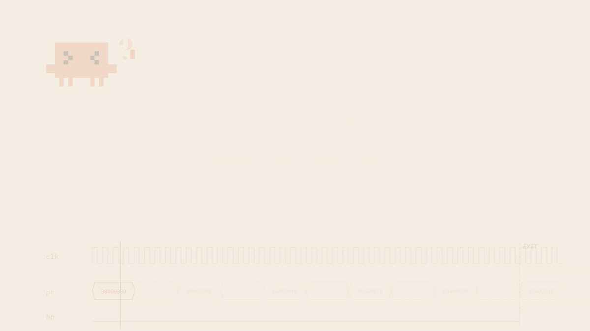

# RARS MCP

RARS MCP gives Claude Code, Codex, Antigravity and other MCP clients access to the
[RARS](https://github.com/TheThirdOne/rars) RISC-V assembler and simulator: assemble and run
programs, step through them in a real debugger, read registers and memory, list symbols and
assembled instructions, write memory images for hardware simulation, and drive a visible RARS
desktop session. It also compiles and runs VHDL testbenches with
[nvc](https://www.nickg.me.uk/nvc/).



<sub>Assemble, run, break on a label, dump a memory image — 20 seconds, no sound.
[Watch the MP4](docs/media/rars-mcp.mp4) for full resolution and the soundtrack.</sub>

## Quick start

Requirements: Node.js 22 and a JDK 11 or later.

```sh
npm ci
npm run build
mkdir -p .cache
curl -fsSL https://github.com/TheThirdOne/rars/releases/download/v1.6/rars1_6.jar -o .cache/rars1_6.jar
scripts/verify-rars.sh
scripts/build-java-bridge.sh
```

Register it with Claude Code. The stdio entry point runs the server in its own process, so
nothing else has to be running:

```sh
claude mcp add --scope user rars -- node /path/to/rars-mcp/dist/src/stdio.js
```

Start your client in the folder holding your `.s` files and the server works there. Examples for
other clients are in `examples/clients/`.

## Which files the server can read

Every path is checked against the workspace folders, after resolving symlinks, and anything
outside them is refused. Folders come from, in order:

- **The client's roots.** A client that advertises the MCP `roots` capability has its roots used
  as workspace folders, so the workspace follows the client's project with no configuration.
- **`RARS_WORKSPACE`.** One or more folders separated by `:` (`;` on Windows). Relative paths
  resolve against the first one.
- **The starting folder.** Without `RARS_WORKSPACE`, the stdio entry point uses the folder the
  client started it in.

## Tools

- **`rars_status`** — check the setup without writing a program: RARS and Java versions, the bridge
  JAR, workspace folders and client roots, open sessions, and the `tclsh` used by `do_file_check` and
  the VHDL simulator. For `tclsh` and the simulator it gives the executable, where it was found on
  `PATH`, its version, and the variable that selects it (`TCLSH`, `VHDL_SIMULATOR`). Each missing
  piece is reported in its own field.

### Running programs

- **`rars_assemble`** — assemble source files and return structured diagnostics.
- **`rars_run`** — run them. Options: `stdin`, `programArgs`, `registers`, `memoryRanges`,
  `instructionCount`, `maxSteps`, `timeoutMs`. Requested registers and memory come back as
  structured values, not raw RARS text:

  ```json
  { "registers": { "t0": { "hex": "0xfffff000", "signed": -4096 } },
    "memory": [{ "address": "0x10010000", "hex": "0x6c6c6568", "signed": 1819043176 }],
    "instructionCount": 22 }
  ```
- **`rars_eval`** — expected results for up to 1024 RV32I/M ALU cases, such as
  `{ "op": "slt", "rs1": "0xFFFFFFFB", "rs2": "0x7FFFFFFF" }`, with `imm` in place of `rs2` for
  `addi`, `slti`, `sltiu`, `xori`, `ori`, `andi`, `slli`, `srli`, `srai`. The cases run in one generated
  program, and each comes back with `rd` as `hex`, `signed` and `unsigned` plus a `zero` flag.
  `format: "vhdl"` also returns a constant table to paste into a testbench. It reads the results
  through a label dump, so it requires the bridge.

`rars_assemble`, `rars_run`, and `rars_debug_start` accept `source` instead of `files` for
throwaway programs. Pass a string for one `inline.s` file, or an array such as
`[{ "name": "main.s", "text": "..." }, { "name": "lib.s", "text": "..." }]` for several files.

Both accept `dump`, which uses RARS's memory-image dumper. Omit `file` to return text formats as
`text` (`HexText` also returns normalized `words`) or binary formats as `bytesBase64`; include a
workspace-relative `file` to write the image there as before:

```json
"dump": [{ "segment": ".text", "format": "HexText", "file": "mem/imem.hex" }]
```

`segment` is `.text`, `.data`, a range like `0x400000-0x10000000`, or an exact-length object such
as `{ "address": "0x10010000", "words": 180 }`. `{ "label": "results", "words": 180 }` resolves
the start through the headless bridge's symbol table, so label dumps require the bridge to be
configured. `words` is at most 65536. `format` is one of `SegmentWindow`, `HexText`, `AsciiText`,
`HEX`, `Binary`, `BinaryText`. With `rars_assemble` the image is produced without running the
program. For file-backed dumps, the target folder must already exist.

### Encoding instructions

- **`rars_encode`** — encode up to 200 instructions with RARS's own assembler. Each comes back
  with its basic form and one word per basic instruction (a pseudo-instruction such as `li` may
  give two). A word has its hex, its format (`R`, `R4`, `I`, `S`, `B`, `U` or `J`) and its fields as
  numbers:

  ```json
  { "source": "sw t2, -4(sp)", "basic": ["sw x7,0xfffffffc(x2)"],
    "words": [{ "hex": "0xfe712e23", "format": "S",
                "fields": { "opcode": 35, "funct3": 2, "rs1": 2, "rs2": 7, "imm": -4 } }] }
  ```

  - `imm` is signed and already put back together for `S`, `B` and `J`; for `U` it is the 20-bit
    upper value. Shift-immediates are `I` with `shamt` and `funct7`; `fmadd` and the other fused
    multiply-adds are `R4` with `rs3` and `funct2`.
  - A branch or jump target may be a number, read as a byte offset from the instruction:
    `beq x1, x2, -8`. RARS itself takes only a label there, so the tool puts a label at that offset.
  - The instructions are assembled one after another as one program, so one can branch to a label
    on another.
  - An instruction RARS rejects comes back as `{ source, error }` with RARS's message. The call
    fails only when no instruction encodes.

### Debugging

- **`rars_debug_start`** — start an isolated debugger session on one or more files.
- **`rars_debug_command`** — `step`, `backstep`, `continue`, `pause`, `reset`, `terminate`,
  `breakpoint_add`, `breakpoint_remove`.
  - A breakpoint `address` may be a number, a code label such as `EXIT`, or a source location
    such as `prob1a.s:17`.
  - `continue` takes an optional `maxSteps` (1,000,000 by default).
  - Every step and continue reports why it stopped: `step`, `breakpoint`, `step_limit`, `exited`,
    `ran_off_end`, `exception` or `terminated`. A program that has terminated refuses to run
    until the session is reset.
- **`rars_inspect`** — registers (including `pc`) and bounded memory as `{ hex, signed }`, plus
  `includeSymbols` for the symbol table and `instructions` for a window of the assembled program
  with each instruction's address, machine code, basic form, source line and file.
  - `instructions: { around, count }` returns `count` instructions (10 by default, at most 200)
    centred on `around`: `pc` (the default), a code label, an address, or `file:line`. With an
    even `count` the extra instruction comes after. `instructions: {}` is the 10 around `pc`.
  - `instructions: { from, to }` returns every instruction from one location to the other,
    inclusive, and refuses a range of more than 200.
  - An unknown label, or an address with no instruction, is an error. The exception is `pc` with
    no instruction, as after the program exits: the window then ends at the last instruction below
    `pc`, so `instructions: {}` shows the program's last 10.
  - `includeInstructions: true` still returns the whole program, but is deprecated.
- **`rars_modify`** — write registers or memory.
- **`rars_session_list`**, **`rars_session_close`** — a session with no requests for
  `RARS_SESSION_IDLE_MS` closes itself and then reports `SESSION_EXPIRED`.

### The visible desktop session

- **`rars_live_connect`**, **`rars_live_command`** — drive the RARS application you can see.

### VHDL

`vhdl_compile`, `vhdl_run` and `vhdl_mutate` run nvc, which is installed separately
(`brew install nvc` on macOS) and is not in the Docker image; set `VHDL_SIMULATOR` if it is not on
`PATH`. They build the design library in a temporary folder that is removed after each call, so
only a requested wave file is written to the workspace, and they share the wall-clock and output
limits of a RARS run.

- **`vhdl_compile`** — analyse VHDL files in the given order and return diagnostics with file, line
  and column. Options: `std` (`93`, `02`, `08` or `19`; `08` by default, `02` matches Questa's
  default) and `work`, the library name (`work` by default).
- **`vhdl_run`** — analyse the files, elaborate `testbench` and run it. Options: `std`, `work`,
  `stopTime` (such as `"1 us"`), `generics` (such as `{ "WIDTH": "8" }`) and `wave`. Every `report`
  and assertion comes back with its simulation time and source location:

  ```json
  { "ok": false, "exitCode": 1,
    "messages": [{ "time": "20ns", "severity": "error", "text": "count is 5, expected 4",
                   "source": { "file": "/project/failing_tb.vhd", "line": 12, "column": 12 } }] }
  ```

  - An assertion of severity `error` or `failure` stops the run and sets `ok` to `false`. A runtime
    error found by the simulator, such as an index out of range, has severity `fatal`.
  - A component with no matching entity is left unbound and its instances do nothing, so the
    testbench can pass without testing anything. `vhdl_run` reports each one as a `warning`
    diagnostic.
  - Without `stopTime` the run lasts until no events remain, or until the wall-clock limit.
  - `wave: { "file": "waves/tb.vcd" }` writes a waveform of the run. `format` is `vcd`, which
    `wave_query` reads, or `fst`, the default for a file ending in `.fst`. The target folder must
    already exist.
- **`vhdl_mutate`** — check that testbenches catch real bugs. Each mutation is applied to a copy
  of `file` in a temporary folder, and each of `testbenches` (`{ "top", "files" }`, where `files`
  must include `file`) runs with the copy in its place. A testbench catches the mutation when it
  fails. `mutations` are literal substitutions, `{ "find", "replace" }` with an optional `name`
  and `occurrence` (counted from 1; every match by default), and a `find` that matches nothing is
  an error. Without them, each operator in the file's statements becomes one mutation, up to 64:
  `+`/`-`, `and`/`or`, `=`/`/=`, `<`/`>=`, `<=`/`>`, `'0'`/`'1'` in assignments, and removing
  `not`. Options: `std`, `stopTime` and `timeoutMs`, the limit for each run.

  ```json
  { "mutations": [{ "name": "line 18: + -> -", "line": 18, "caught": true,
                    "caughtBy": ["adder_tb"], "missedBy": ["adder_weak_tb"] }],
    "score": { "caught": 1, "total": 1, "ratio": 1 } }
  ```

  The unmutated design runs first. If a testbench fails on it, no mutation runs and the result is
  an error, as it is for a mutated copy that does not analyse. A low score is not an error.
- **`wave_query`** — read signal values from a VCD waveform at chosen times, so a check like "is
  `s_ovfl` 1 at 20 ns?" needs no waveform viewer. Signals are hierarchical names such as
  `tb_alu.s_ovfl` or `tb_alu/dut/s_sum`, matched ignoring case. Times look like `20 ns`, `1.5us`,
  or a bare `100` in the file's timescale units. Each value is the last change at or before that
  time, and a time before the first dump reads as `x`:

  ```json
  { "time": "20 ns", "tb_alu.s_sum": { "bits": "0111", "hex": "0x7", "unsigned": 7, "signed": 7 },
    "tb_alu.s_ratio": { "real": -2 }, "tb_alu.s_phase": { "string": "check" } }
  ```

  `hex`, `unsigned` and `signed` are `null` when a bit is not 0 or 1. An unknown signal is an error
  that lists the signals sharing its last name. nvc writes VCD with `--wave=tb.vcd --format=vcd`
  and GHDL with `--vcd=tb.vcd`; FST and GHW files, and files over `WAVE_MAX_BYTES`, are refused.

- **`do_file_check`** — dry-run a Questa or ModelSim `.do` script without a simulator. Returns
  the files it compiles, in order, with each one's library, VHDL standard and whether it exists,
  plus the `vlib` libraries, the `vsim` top and any Tcl error with its file and line. `std` sets
  the standard for `vcom` calls that name none.

`do_file_check` runs the script with `tclsh` 8.5 or later, which the Docker image does not
include. `vlib`, `vmap`, `vcom`, `vlog`, `vsim`, `run`, `add wave` and the other common Questa
commands are stubs that record their calls. The script has no shell or file access: nested `do`
files and `file exists` are answered from the workspace. Relative paths resolve from the script's
folder, as if Questa ran it there.

## Run in Docker

Requirements: Docker Desktop with Compose.

```sh
mkdir -p workspace
docker compose up -d --build
curl http://127.0.0.1:3000/health
```

Put `.s` files in `workspace/`. HTTP-capable clients connect to `http://127.0.0.1:3000/mcp`.
Stdio-only clients use the proxy, which forwards to that server:

```sh
docker exec -i rars-mcp node dist/src/stdio-proxy.js
```

View logs with `docker compose logs -f`, stop with `docker compose down`, and rebuild after an
update with `docker compose build --no-cache && docker compose up -d`.

## Desktop session

```sh
./scripts/launch-rars-mcp.command
```

The launcher opens RARS and writes protected discovery files into the ignored `.runtime/`
directory. Call `rars_live_connect`, then use its session ID with `rars_live_command`. See
`docs/live-session.md` for the commands and how unsaved buffers are handled.

## Configuration

| Variable | Default | Purpose |
|---|---|---|
| `RARS_WORKSPACE` | the starting folder (stdio) | Folders the server may read, separated by `:` |
| `RARS_JAR` | `.cache/rars1_6.jar` | The RARS JAR |
| `RARS_BRIDGE_JAR` | `java/bridge/build/rars-mcp-bridge.jar` | The Java bridge used by debugger sessions |
| `RARS_BRIDGE_HOST` | `127.0.0.1` | Host of the visible desktop session |
| `RARS_LIVE_DISCOVERY_DIR` | `.runtime` | Where the launcher writes its port and token |
| `RARS_EXECUTION_TIMEOUT_MS` | `10000` | Wall-clock limit for one run |
| `RARS_MAX_OUTPUT_BYTES` | `1048576` | Output captured per run |
| `RARS_MAX_INSPECTION_BYTES` | `65536` | Limit on one inspection |
| `RARS_SESSION_IDLE_MS` | `1800000` | Idle time before a debugger session closes |
| `WAVE_MAX_BYTES` | `67108864` | Largest waveform file `wave_query` reads |
| `JAVA_EXECUTABLE` | `java` | Java binary to run |
| `TCLSH` | `tclsh` | Tcl shell `do_file_check` runs scripts with |
| `VHDL_SIMULATOR` | `nvc` | nvc executable used by the VHDL tools |
| `PORT` | `3000` | HTTP entry point port |
| `RARS_MCP_URL` | `http://127.0.0.1:3000/mcp` | Server the stdio proxy forwards to |

Paths default to this checkout and are resolved from the package, not the current directory, so
the server works no matter where it is started. The Docker image sets them explicitly.

## Development

```sh
npm run lint                                   # tsc --noEmit
RARS_JAR="$PWD/.cache/rars1_6.jar" npm run test:run   # vitest once; RARS-backed tests need the JAR
scripts/test-java-bridge.sh                    # Java bridge self-tests
npm run build
```

The VHDL tests run only when `nvc`, or the executable in `VHDL_SIMULATOR`, is available.

`npm run start:stdio` runs the stdio entry point, `npm run start:http` the HTTP server, and
`npm run start:proxy` the proxy used inside Docker.

See `docs/security.md` before changing network bindings or workspace folders,
`docs/troubleshooting.md` for recovery steps, and `docs/bug-log.md` for fixed defects and how
they were found.
